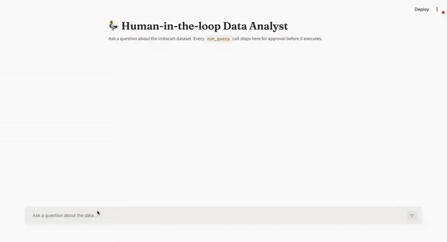

# Human-in-the-Loop Data Analyst

Text-to-SQL agents that run queries automatically can silently return the wrong number, or run a query that changes data. In this app, a plain-English question becomes a SQL query that a person reviews, and nothing runs until they click approve.

## How it works
Streamlit UI → OpenAI Responses API (`gpt-4o-mini`) → MCP server → DuckDB (Instacart data)

- The model can use three tools: `list_tables`, `describe_table` and `run_query`.
- **Approval gate:** `run_query` is set to `require_approval`. Before running it, the API pauses and sends an approval request to the UI. The pause is enforced by OpenAI's API, not by a button handler in this app's code.
- **Second safety check:** the server itself rejects anything that isn't a plain `SELECT`, so even a mistakenly approved query can't change data.
- **Why only `run_query` is gated:** the first version required approval for every tool call, which meant 2–3 clicks before seeing a real query. The two schema tools only return table and column names, so gating them added clicks without adding safety.

## Results
- Tested with five natural-language questions, including one deliberate rejection.
- Zero queries ran without approval.
- **Rejection:** when a query is rejected, the model proposes a new one, and that new query needs its own approval. Retrying can't get around the gate.
- **Example:** "What are the top 5 most reordered products?" returned Banana (7,084 reorders), Bag of Organic Bananas (6,170), Organic Strawberries (4,188), Organic Baby Spinach (3,700) and Organic Hass Avocado (3,416).

## What broke
The API only connects to MCP servers that are reachable over the internet, so local development would need an ngrok tunnel. The free tier of ngrok gives a new URL every time it restarts. Running a command in the wrong terminal tab killed the tunnel, while the old URL kept showing as if nothing had happened. Running the MCP server, ngrok and Streamlit in three separate terminal tabs fixed it.

## Run it
1. Add the Instacart CSVs to `data/` (see `data/README.md`)
2. `pip install -r requirements.txt`
3. Terminal 1: `python mcp_server/duckdb_server.py`
4. Terminal 2: `ngrok http 8000`, then copy the HTTPS URL
5. Copy `.env.example` to `.env` and fill in `OPENAI_API_KEY` and `MCP_SERVER_URL` (the tunnel URL + `/mcp`)
6. Terminal 3: `streamlit run app.py`

## Stack
Python · DuckDB · FastMCP · OpenAI Responses API · Streamlit
